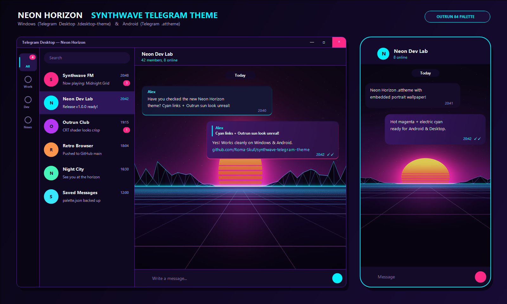

# Neon Horizon — Synthwave Telegram Theme

Официальная синтвейв-тема оформления для клиентов **Telegram Desktop (Windows)**, **Telegram (Android)** и **Telegram (iPhone / iOS)** в эстетике **Synthwave / Outrun 84**, созданная в единой палитре с проектами [retro-browser](https://github.com/Roma-Skull/retro-browser) и [synthwave-wallpapper](https://github.com/Roma-Skull/synthwave-wallpapper).



---

## Платформы и файлы

- **Windows — Telegram Desktop ([`windows/`](windows/)):**
  - [`windows/NeonHorizonSynthwave.tdesktop-theme`](windows/NeonHorizonSynthwave.tdesktop-theme) — готовый пакет темы (все 467 цветовых ключей из [`colors.tdesktop-theme`](windows/colors.tdesktop-theme), 1–2 px неоновая подсветка нижней грани баблов, 1 px фиолетовые разделители панелей и широкоформатные обои [`background.jpg`](windows/background.jpg) `1920x1080`).
- **Android — официальный Telegram ([`android/`](android/)):**
  - [`android/NeonHorizonSynthwave.attheme`](android/NeonHorizonSynthwave.attheme) — полная тема (`772` ключа интерфейса, градиентные исходящие пузыри, кольца Stories, подсветка кода, таблицы, панель стикеров/реакций) со встроенным портретным фоном `1080x2160` (`WPS`/`WPE`).
  - [`android/NeonHorizonSynthwave-no-bg.attheme`](android/NeonHorizonSynthwave-no-bg.attheme) — облегчённый вариант с 4-цветным синтвейв-градиентом чата вместо растрового фона.
- **iPhone / iOS — официальный Telegram ([`ios/`](ios/)):**
  - [`ios/NeonHorizonSynthwave.tgios-theme`](ios/NeonHorizonSynthwave.tgios-theme) — полная тема в официальном формате `.tgios-theme` с нативным 4-цветным синтвейв-градиентом, градиентными баблами и реальной неоновой обводкой и свечением вокруг баблов (`stroke` + `shadow`).
  - [`ios/background_ios.jpg`](ios/background_ios.jpg) — опциональные портретные обои `1290x2796` (iPhone Pro / Pro Max) для установки через галерею Telegram iOS.

---

## Палитра Neon Horizon

Единый источник палитры — [`common/palette.json`](common/palette.json):

| Роль | Цвет | Назначение |
| :--- | :--- | :--- |
| Глубокий космос / Боковая панель | `#080513` / `#090514` | Фон левой панели папок, разделители, тени |
| Основное полотно / Список чатов | `#0E0920` / `#140B29` | Окна, список диалогов, меню, панель ввода |
| Повышенные поверхности / Hover | `#1B0F38` / `#2D1659` | Карточки, активный чат, наведение и ripple |
| Электрический циан | `#00F0FF` / `#48ECFF` | Ссылки, галочки прочтения, онлайн-индикаторы, ползунки |
| Неоновая маджента | `#FF2A85` / `#FF5CA3` | Основные кнопки, счётчики непрочитанных, переключатели |
| Синтвейв-фиолет | `#B537F2` | Контуры, разделители, исходящие акценты, скроллбар |
| Входящие / Исходящие пузыри | `#150D2B` / `#2A124A` → `#3A1766` | Высококонтрастные пузыри поверх заката и сетки |

---

## Быстрая установка

### Windows (Telegram Desktop)
1. Скачайте `NeonHorizonSynthwave-windows.tdesktop-theme` со страницы [Releases](https://github.com/Roma-Skull/synthwave-telegram-theme/releases) (или возьмите [`windows/NeonHorizonSynthwave.tdesktop-theme`](windows/NeonHorizonSynthwave.tdesktop-theme) из репозитория).
2. Перетащите файл в окно Telegram Desktop (или отправьте его себе в *Избранное* и кликните по нему).
3. Нажмите **Применить тему** (*Apply Theme*).

### Android (Telegram)
1. Скачайте `NeonHorizonSynthwave-android.attheme` со страницы [Releases](https://github.com/Roma-Skull/synthwave-telegram-theme/releases) (или [`android/NeonHorizonSynthwave.attheme`](android/NeonHorizonSynthwave.attheme)).
2. Откройте файл внутри Telegram для Android (например, через *Избранное*).
3. Нажмите **Применить** (*Apply*).

### iPhone / iOS (Telegram)
1. Скачайте `NeonHorizonSynthwave-ios.tgios-theme` со страницы [Releases](https://github.com/Roma-Skull/synthwave-telegram-theme/releases) (или [`ios/NeonHorizonSynthwave.tgios-theme`](ios/NeonHorizonSynthwave.tgios-theme)).
2. Отправьте файл себе в *Избранное* и нажмите на него в Telegram на iPhone → **Применить тему** (*Apply Theme*).
3. *(Опционально)* Если хотите поставить фон с Outrun-солнцем и сеткой: скачайте [`ios/background_ios.jpg`](ios/background_ios.jpg) и выберите его в **Настройки → Оформление → Обои чата → Выбрать из галереи**.

---

## Пересборка и упаковка релиза из исходников

Для пересборки тем и процедурных обоев достаточно PowerShell (встроен в Windows) и .NET:

```powershell
# 1. Сгенерировать процедурные обои (Windows 1920x1080, Android 1080x2160, iOS 1290x2796) и превью img/preview.png
powershell -NoProfile -ExecutionPolicy Bypass -File scripts\generate_wallpapers.ps1

# 2. Собрать и провалидировать темы для windows/, android/ и ios/
powershell -NoProfile -ExecutionPolicy Bypass -File scripts\build_themes.ps1

# 3. Упаковать релизные архивы и SHA-256 контрольные суммы в dist/
powershell -NoProfile -ExecutionPolicy Bypass -File scripts\package.ps1 -Version 1.0.2
```

### Схема релизов и автоопределение изменений

Workflow [`.github/workflows/release.yml`](.github/workflows/release.yml) использует задачу `detect-changes`:
- **Общий тег `v*` (например `v1.0.3`):** проверяет `git diff` с предыдущим тегом для каждой платформы (`windows/`, `android/`, `ios/` + `common/`, `scripts/`) и собирает/публикует **только те платформы, где были изменения**.
- **Теги конкретной платформы (`windows-v*`, `android-v*`, `ios-v*`):** принудительно собирают только выбранную платформу.
- **Ручной запуск (`workflow_dispatch`):** позволяет выбрать `auto`, `All`, `Windows`, `Android` или `iOS`.

### Структура проекта

```text
synthwave-telegram-theme/
├── .github/workflows/release.yml           # Автосборка и публикация релизов по тегам (v*, windows-v*, android-v*, ios-v*)
├── common/
│   ├── palette.json                        # Единая палитра Neon Horizon
│   └── android_base.json                   # Базовая карта ключей Telegram Android
├── scripts/
│   ├── generate_wallpapers.ps1             # Процедурный генератор обоев и UI-превью
│   ├── build_themes.ps1                    # Генератор и валидатор тем (.tdesktop-theme, .attheme, .tgios-theme)
│   └── package.ps1                         # Сборщик дистрибутивов и SHA-256 в dist/
├── windows/                                # Тема для Telegram Desktop (Windows)
├── android/                                # Тема для Telegram (Android)
├── ios/                                    # Тема для Telegram (iPhone / iOS)
└── img/                                    # Скриншот-превью
```
